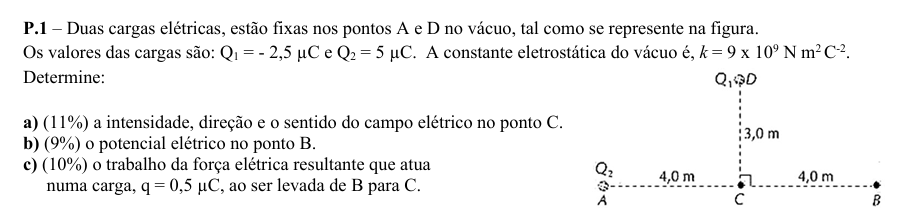

# A)

## Passo 1 — Traduzir o enunciado para linguagem normal

> “Duas cargas elétricas estão fixas nos pontos A e D no vácuo.”

### 1. O que é uma carga elétrica?

Na sebenta do professor, a carga elétrica é apresentada como uma propriedade da matéria, podendo existir carga positiva ou negativa. A unidade utilizada é o **coulomb, C**. 

Neste exercício existem **duas cargas**:

\[
Q_1=-2,5\,\mu C
\]

e

\[
Q_2=+5\,\mu C
\]

Não se preocupe ainda com o \(\mu C\). Neste passo basta perceber:

- \(Q_1\) é uma carga **negativa**, porque tem o sinal **−**;
- \(Q_2\) é uma carga **positiva**, porque tem o sinal **+**.


---

### 2. Onde estão essas cargas?

Olhe apenas para o desenho:

```text
                 D
                 ●  Q1
                 |
                 | 3 m
                 |
A ●--------------●--------------● B
  Q2             C
       4 m              4 m
```

Portanto:

- a carga **\(Q_1\)** está no ponto **D**;
- a carga **\(Q_2\)** está no ponto **A**.

Muito importante:

**C e B não têm cargas.**

São simplesmente **pontos do espaço** onde o exercício nos vai pedir para calcular alguma coisa.

---

### 3. O que significa as cargas “estarem fixas”?

Significa simplesmente:

> as cargas \(Q_1\) e \(Q_2\) **não se mexem**.

Ficam sempre em A e D.

Não temos de calcular velocidades nem movimentos dessas duas cargas.

---

### 4. Que distâncias o desenho nos dá?

Temos:

\[
AC=4\,m
\]

ou seja, de **A até C existem 4 metros**.

Temos:

\[
CD=3\,m
\]

ou seja, de **C até D existem 3 metros**.

E:

\[
CB=4\,m
\]

ou seja, de **C até B existem 4 metros**.

O pequeno quadrado desenhado em C significa que:

\[
AC \perp CD
\]

isto é, a linha horizontal e a vertical fazem um ângulo de:

\[
90^\circ
\]


### 5. Então, por enquanto, o que temos de guardar?

Só isto:

```text
                 Q1 negativa
                     D ●
                       |
                       | 3 m
                       |
Q2 positiva   A ●------●------● B
                   4 m C  4 m
```

Temos **duas cargas que criam efeitos elétricos à sua volta**:

- \(Q_1\), negativa, em D;
- \(Q_2\), positiva, em A.

E o exercício vai perguntar o que acontece em determinados pontos, como **C** e **B**.

Ainda **não precisamos de saber como se calcula nada**.


---


## Passo 2 — O que significa “campo elétrico no ponto C”?

Agora vamos olhar **só para a alínea a)**, sem fazer contas.

Ela pede:

> “a intensidade, direção e sentido do **campo elétrico no ponto C**.”

A primeira dificuldade é perceber o que é esse tal **campo elétrico**.

Na sebenta do professor, o campo elétrico é apresentado através da relação entre a força elétrica e uma **carga de prova positiva** colocada num ponto:

\[
\vec E=\frac{\vec F_e}{q_0}
\]

e a sebenta identifica \(q_0\) como uma **carga de prova positiva**. 2_3_aulas_cargas_campos_potenci… 2_3_aulas_cargas_campos_potenci…

Mas esqueça a fórmula por enquanto.

### Imagine assim

As duas cargas que estão em A e D alteram o espaço à sua volta.

É como se cada uma criasse uma espécie de **“zona de influência elétrica”** invisível.

Essa zona de influência é aquilo a que chamamos:

**campo elétrico**.

Portanto, quando o professor pergunta:

> “qual é o campo elétrico no ponto C?”

está, de forma muito simples, a perguntar:

> **Se eu colocasse uma pequeníssima carga positiva no ponto C, para que lado ela seria empurrada ou puxada e com que intensidade?**

É exatamente por isso que a sebenta fala numa **carga de prova positiva** \(q_0\). 2_3_aulas_cargas_campos_potenci…

---

### No nosso exercício

Temos:

```text
                 Q1 negativa
                     D ●
                       |
                       |
                       |
Q2 positiva   A ●------● C
```

No ponto **C não existe uma carga**.

Estamos apenas a perguntar:

> “Que efeito elétrico produzem \(Q_1\) e \(Q_2\) naquele ponto do espaço?”

E há aqui uma ideia muito importante:

**as duas cargas influenciam C ao mesmo tempo.**

Ou seja:

- \(Q_1\) cria um campo elétrico em C;
- \(Q_2\) também cria um campo elétrico em C;
- depois teremos de perceber o efeito conjunto dos dois.

A sebenta diz precisamente que o campo resultante num ponto é a soma dos campos produzidos individualmente pelas cargas. 2_3_aulas_cargas_campos_potenci…

Mas **ainda não vamos somar nada**.

---

### E porque é que o enunciado pede “intensidade, direção e sentido”?

Porque o campo elétrico não é apenas um número.

Precisamos de saber três coisas:

**Intensidade** → quão forte é o efeito elétrico.

**Direção** → a orientação da linha onde atua, por exemplo horizontal ou vertical.

**Sentido** → para que lado nessa direção: direita/esquerda, cima/baixo.

É o mesmo princípio das grandezas vetoriais apresentado nas primeiras aulas: uma grandeza vetorial tem valor, direção e sentido. 1_aula inicial

Por exemplo, dizer apenas:

> “o campo vale 100”

não chegaria.

Precisávamos de algo como:

> “tem intensidade 100, é horizontal e aponta para a direita.”

---

### O único conceito que quero que retenha neste passo

Quando vir:

> **“campo elétrico no ponto C”**

pense:

> **“Se eu colocasse uma pequena carga positiva em C, que influência elétrica sentiria ali?”**

Ainda não estamos a calcular.

Se isto ficou claro, diga-me **“continuar”**. No **Passo 3**, vemos apenas uma coisa: **como saber para que lado aponta o campo criado por uma carga positiva e por uma carga negativa**. É isso que nos permitirá olhar para o desenho e perceber as setas antes de tocar em qualquer fórmula.


---

Sim — essa é exatamente a ideia que precisamos de fixar agora.

Uma **carga positiva** não “puxa tudo para ela”. Depende do sinal da outra carga.

Na sebenta do professor está escrito:

> cargas com o mesmo sinal repelem-se e cargas de sinais opostos atraem-se. 2_3_aulas_cargas_campos_potenci…

Como, para definir o campo elétrico, imaginamos uma **carga de prova positiva** \(q_0\), 2_3_aulas_cargas_campos_potenci… então:

- uma carga **positiva** vai **empurrar** essa carga de prova positiva para longe;
- uma carga **negativa** vai **puxar** essa carga de prova positiva para si.

No nosso exercício, por exemplo, \(Q_2\) é positiva. Se imaginarmos uma pequena carga positiva no ponto C, \(Q_2\) vai **repeli-la**, isto é, empurrá-la para longe de A.

Por agora, guarde só esta regra:

**positiva → empurra uma carga de prova positiva para longe**  
**negativa → puxa uma carga de prova positiva para si**


---


# Passo 3

Perfeito. Vamos ficar **só no Passo 3**.

## Passo 3 — Para que lado aponta o campo elétrico?

A regra vem diretamente da sebenta:

- cargas com o **mesmo sinal repelem-se**;
- cargas com **sinais opostos atraem-se**.

E como o campo elétrico é definido usando uma **carga de prova positiva \(q_0\)**, basta imaginar essa carga positiva colocada no ponto onde queremos estudar o campo. 

Então:

- uma carga **positiva** empurra \(q_0\) para longe;
- uma carga **negativa** puxa \(q_0\) para si.

### Aplicando ao nosso desenho

Temos:

```text
                 Q1 negativa
                     D ●
                       |
                       |
Q2 positiva   A ●------● C
                     +q0
```

Primeiro olhamos só para \(Q_2\), que está em A e é **positiva**.

Como \(q_0\) também é positiva:

- positiva com positiva → repelem-se.

Logo, \(Q_2\) empurra \(q_0\) para longe de A.

Como C está à direita de A, a seta fica:

```text
Q2 positiva   A ●------● C
                         →
                    campo de Q2
```

Portanto, no ponto C, o campo criado por \(Q_2\) aponta **para a direita**.

Agora olhamos só para \(Q_1\), que está em D e é **negativa**.

Uma carga negativa atrai a carga de prova positiva.

Logo, \(Q_1\) puxa \(q_0\) para D:

```text
                 Q1 negativa
                     D ●
                       ↑
                       |
                       |
                       ● C
```

Portanto, no ponto C, o campo criado por \(Q_1\) aponta **para cima**.

O que quero que retenha deste passo é apenas isto:

- \(Q_2\) positiva em A → campo em C para a **direita**;
- \(Q_1\) negativa em D → campo em C para **cima**.

Se isto estiver claro, diga-me **“continuar”** e no Passo 4 vemos apenas por que razão existem **dois campos em C ao mesmo tempo** e o que significa “campo resultante”, ainda sem fazer contas.


---


## Passo 4 — Porque existem dois campos em C e o que é o “campo resultante”?


No ponto C, as duas cargas atuam ao mesmo tempo:

- \(Q_2\), que está em A, cria um campo em C para a **direita**;
- \(Q_1\), que está em D, cria um campo em C para **cima**.

Isto significa que, em C, não temos de escolher “ou um ou outro”. Temos os dois efeitos ao mesmo tempo.

Imagine assim:

```text
                 ↑  campo criado por Q1
                 |
                 |
                 ● C --------→ campo criado por Q2
```

Agora pense numa situação do dia a dia: se alguém o empurra para a direita e outra pessoa o empurra para cima ao mesmo tempo, o resultado não é só direita nem só cima. O movimento resultante tende a ser na diagonal.

É exatamente esta ideia:

```text
                 ↑
                 |   ↗ campo resultante
                 |  /
                 | /
                 ●────────→
```

Portanto, o **campo resultante em C** é uma única seta que representa o efeito conjunto dos dois campos.

Ainda não sabemos o comprimento dessa seta, porque isso depende de saber qual dos dois campos é mais forte. É isso que vamos descobrir depois com a fórmula.

Por agora, retenha apenas:

> **Campo resultante = combinação dos campos criados por todas as cargas naquele ponto.**

No nosso exercício, como um aponta para cima e outro para a direita, o campo resultante vai apontar **para cima e para a direita**.

Se isto ficou claro, diga-me **“continuar”** e no Passo 5 vemos só o que significa a **intensidade do campo elétrico** e porque aparece a fórmula \(E=kQ/r^2\).


---


## Passo 5 — O que significa a intensidade do campo elétrico?

Agora vamos perceber **só a intensidade**. Ainda não vamos calcular o campo total.

Na sebenta, o módulo do campo elétrico criado por uma carga pontual aparece como:

\[
E = k\frac{Q}{d^2}
\]


E no formulário do professor aparece a mesma relação:

\[
|E|=k\frac{q}{r^2}
\]

Formulário

### Mas o que quer dizer isto em linguagem normal?

A **intensidade do campo elétrico** diz-nos:

> **quão forte é a influência elétrica daquela carga num determinado ponto.**

No nosso exercício, queremos saber quão forte é a influência de cada carga no ponto C.

A fórmula é:

\[
E=k\frac{|Q|}{r^2}
\]

Vamos traduzir cada símbolo:

- \(E\) = intensidade do campo elétrico;
- \(k\) = uma constante;
- \(Q\) = valor da carga que está a criar o campo;
- \(r\) = distância entre essa carga e o ponto onde queremos saber o campo.

No nosso caso, o ponto é C.

---

### A ideia mais importante da fórmula

Veja esta parte:

\[
\frac{Q}{r^2}
\]

Ela diz duas coisas muito simples.

Quanto **maior for a carga**, maior tende a ser o campo.

Quanto **mais longe estivermos da carga**, menor fica o campo.

E a distância aparece ao quadrado:

\[
r^2
\]

Portanto, afastarmo-nos tem um efeito muito forte na diminuição do campo.

---

### Aplicando só a ideia ao desenho

Temos:

```text
                 Q1
                 ●
                 |
               3 m
                 |
                 ● C
                 
Q2 ●------4 m----● C
```

Então:

- para saber o campo criado por \(Q_1\) em C, usamos a distância **3 m**;
- para saber o campo criado por \(Q_2\) em C, usamos a distância **4 m**.

Isto é importante: usamos sempre a distância entre **a carga que cria o campo** e **o ponto onde estamos a estudar o campo**.

---

### E porque usamos \(|Q|\) quando falamos só da intensidade?

Porque a intensidade é apenas “quão forte”.

O sinal \(+\) ou \(−\) serve para determinar o **sentido**, que já vimos antes.

Portanto:

- para calcular o valor da intensidade, usamos o valor da carga sem o sinal;
- para saber para onde aponta a seta, usamos o sinal da carga.

Por exemplo:

\[
Q_1=-2,5\mu C
\]

Para a intensidade, usamos:

\[
|Q_1|=2,5\mu C
\]

Mas continuamos a lembrar-nos de que \(Q_1\) é negativa para saber que o campo aponta para ela.

### O que deve ficar deste passo

> **A fórmula \(E=k|Q|/r^2\) serve para saber quão forte é o campo criado por uma carga a uma certa distância.**

E:

> **o sinal da carga diz-nos o sentido; o valor absoluto da carga entra no cálculo da intensidade.**

Se isto ficou claro, diga-me **“continuar”** e no **Passo 6** fazemos apenas o cálculo do campo criado por \(Q_2\) no ponto C, muito devagar, explicando também o que significa \(\mu C\).


---


## Passo 6 — Calcular apenas o campo criado por \(Q_2\) no ponto C

Neste passo queremos calcular **uma única coisa**:

> Qual é a intensidade do campo elétrico que a carga \(Q_2\), situada em A, cria no ponto C?

Não estamos ainda a calcular o campo total em C.

### 1. O que sabemos pelo enunciado?

A carga que está em A é:

\[
Q_2=+5\,\mu C
\]

E a distância entre A e C é:

\[
AC=4\,m
\]

Podemos visualizar apenas esta parte do exercício:

```text
Q₂ = +5 μC

A ●----------------● C
        4 m
```

Queremos saber **quão forte é o campo criado por \(Q_2\) quando chegamos ao ponto C**.

---

### 2. Que fórmula devemos utilizar?

Vamos diretamente ao **formulário do professor**.

A fórmula apresentada para a intensidade do campo elétrico é:

\[
\boxed{|E|=k\frac{q}{r^2}}
\]

Formulário

A sebenta da Temática 1 apresenta também o campo elétrico de uma carga pontual em função da carga e da distância. 2_3_aulas_cargas_campos_potenci…

Não vamos alterar esta fórmula.

---

### 3. Antes de substituir: o que significa \(5\,\mu C\)?

Temos:

\[
Q_2=5\,\mu C
\]

O símbolo:

\[
\mu
\]

lê-se **micro**.

Na tabela de prefixos fornecida nas aulas do professor:

\[
\boxed{\mu=10^{-6}}
\]

1_aula inicial

Portanto:

\[
5\,\mu C
\]

significa:

\[
\boxed{5\times10^{-6}\,C}
\]

Assim:

\[
Q_2=5\times10^{-6}\,C
\]

Isto não é uma fórmula nova. Estamos apenas a **converter microcoulomb para coulomb**, porque o formulário trabalha com unidades do Sistema Internacional.

---

### 4. Qual é o valor de \(k\)?

Aqui temos de utilizar exatamente a constante fornecida pelo professor.

No final do formulário aparece:

\[
\boxed{k=8,99\times10^9\;N\,m^2\,C^{-2}}
\]

que é a **constante de Coulomb**. Formulário

Portanto:

\[
k=8,99\times10^9
\]

Não vamos arredondar para \(9\times10^9\).

---

### 5. Agora identificamos cada elemento da fórmula

A fórmula do professor é:

\[
|E|=k\frac{q}{r^2}
\]

Temos:

\[
k=8,99\times10^9
\]

A carga é:

\[
q=Q_2=5\times10^{-6}\,C
\]

E a distância entre a carga \(Q_2\) e o ponto C é:

\[
r=4\,m
\]

Portanto, estamos simplesmente a fazer esta correspondência:

\[
\boxed{
\begin{aligned}
k&=8,99\times10^9\\
q&=5\times10^{-6}\\
r&=4
\end{aligned}}
\]

---

### 6. Substituímos os valores na fórmula do professor

Partimos de:

\[
|E|=k\frac{q}{r^2}
\]

Substituímos:

\[
|E_2|=
(8,99\times10^9)
\frac{5\times10^{-6}}{4^2}
\]

Repare numa coisa importante:

O:

\[
4^2
\]

aparece porque na fórmula do professor temos:

\[
r^2
\]

e neste exercício:

\[
r=4\,m
\]

Logo:

\[
r^2=4^2
\]

---

### 7. Calculamos primeiro \(4^2\)

\[
4^2=4\times4
\]

Portanto:

\[
4^2=16
\]

A expressão fica:

\[
|E_2|=
(8,99\times10^9)
\frac{5\times10^{-6}}{16}
\]

---

### 8. Fazemos a multiplicação

Temos:

\[
(8,99\times10^9)(5\times10^{-6})
\]

Primeiro multiplicamos:

\[
8,99\times5=44,95
\]

E nas potências:

\[
10^9\times10^{-6}=10^{9-6}=10^3
\]

Portanto:

\[
(8,99\times10^9)(5\times10^{-6})
=
44,95\times10^3
\]

Como:

\[
44,95\times10^3=44950
\]

ficamos com:

\[
|E_2|=\frac{44950}{16}
\]

---

### 9. Fazemos a divisão

\[
\frac{44950}{16}=2809,375
\]

Portanto:

\[
\boxed{|E_2|=2809,375\ N/C}
\]

Esta é a **intensidade** do campo elétrico criado por \(Q_2\) no ponto C.

---

### 10. E para que lado aponta?

Isto já aprendemos nos passos anteriores.

\(Q_2\) é:

\[
Q_2=+5\,\mu C
\]

Portanto, é uma carga **positiva**.

Imaginando a nossa carga de prova positiva \(q_0\) em C:

```text
Q₂ positiva             q₀ positiva
A ●---------------------● C
                         →
```

Positiva com positiva → **repulsão**.

Por isso, \(Q_2\) empurra a carga de prova para longe de A.

Logo, o campo criado por \(Q_2\) em C aponta:

\[
\boxed{\text{para a direita}}
\]

### Resultado deste passo

Temos apenas:

\[
\boxed{|E_2|=2809,375\ N/C}
\]

com sentido:

\[
\boxed{\rightarrow\ \text{para a direita}}
\]

Ou visualmente:

```text
Q₂ = +5 μC

A ●----------------● C
        4 m          ───────→ E₂
                      2809,375 N/C
```

Não avançamos ainda para \(Q_1\). O essencial deste passo é perceber de onde vieram **\(8,99\times10^9\)**, **\(5\times10^{-6}\)** e **\(4^2\)**.


---


## Passo 7 — Calcular apenas o campo criado por \(Q_1\) no ponto C

Agora fazemos exatamente o mesmo que fizemos para \(Q_2\), mas desta vez com a carga \(Q_1\), que está em D.

Não vamos ainda somar os dois campos.

### 1. O que sabemos pelo enunciado?

A carga em D é:

\[
Q_1=-2,5\,\mu C
\]

E a distância entre D e C é:

\[
DC=3\,m
\]

Visualmente:

```text
        Q1 = -2,5 μC
             D ●
               |
               | 3 m
               |
             C ●
```

Queremos saber a intensidade do campo que \(Q_1\) cria em C.

---

### 2. Usamos a fórmula do professor

No formulário:

\[
\boxed{|E|=k\frac{q}{r^2}}
\]

Formulário

E a sebenta apresenta esta expressão como o **módulo do campo elétrico** criado por uma carga pontual. 2_3_aulas_cargas_campos_potenci…

Como estamos a calcular a **intensidade**, usamos o valor da carga:

\[
2,5\,\mu C
\]

O sinal negativo vai servir depois para determinar o **sentido**.

---

### 3. Converter \(\mu C\) para C

Da tabela do professor:

\[
\mu=10^{-6}
\]

1_aula inicial

Portanto:

\[
2,5\,\mu C
=
2,5\times10^{-6}\,C
\]

Assim, para o cálculo da intensidade:

\[
q=2,5\times10^{-6}\,C
\]

---

### 4. Valor da constante \(k\)

Do formulário do professor:

\[
\boxed{k=8,99\times10^9\ N\,m^2\,C^{-2}}
\]

Formulário

Portanto:

\[
k=8,99\times10^9
\]

---

### 5. Identificamos os valores

Temos:

\[
|E|=k\frac{q}{r^2}
\]

Neste caso:

\[
k=8,99\times10^9
\]

\[
q=2,5\times10^{-6}
\]

\[
r=3
\]

Então:

\[
|E_1|=
(8,99\times10^9)
\frac{2,5\times10^{-6}}{3^2}
\]

---

### 6. Calculamos \(3^2\)

\[
3^2=3\times3=9
\]

Logo:

\[
|E_1|=
(8,99\times10^9)
\frac{2,5\times10^{-6}}{9}
\]

---

### 7. Fazemos a multiplicação

\[
(8,99\times10^9)(2,5\times10^{-6})
\]

Primeiro:

\[
8,99\times2,5=22,475
\]

E:

\[
10^9\times10^{-6}=10^3
\]

Logo:

\[
22,475\times10^3
=
22475
\]

Portanto:

\[
|E_1|=\frac{22475}{9}
\]

---

### 8. Fazemos a divisão

\[
\frac{22475}{9}
=
2497,22
\]

aproximadamente.

Assim:

\[
\boxed{|E_1|\approx2497,22\ N/C}
\]

---

### 9. Para que lado aponta este campo?

Agora usamos o sinal de \(Q_1\).

Temos:

\[
Q_1=-2,5\,\mu C
\]

Logo \(Q_1\) é **negativa**.

A sebenta diz que cargas de sinais opostos se atraem. 2_3_aulas_cargas_campos_potenci…

Como imaginamos uma carga de prova positiva \(q_0\) em C, a carga negativa \(Q_1\) puxa-a para si:

```text
       Q1 negativa
           D ●
             ↑
             |
             |
           C ●
            +q0
```

Portanto, o campo criado por \(Q_1\) em C aponta:

\[
\boxed{\text{para cima}}
\]

### Resultado deste passo

\[
\boxed{|E_1|\approx2497,22\ N/C}
\]

com sentido:

\[
\boxed{\uparrow\ \text{para cima}}
\]

Neste momento temos então, separadamente:

\[
E_1\approx2497,22\ N/C \quad \uparrow
\]

e, do passo anterior:

\[
E_2=2809,375\ N/C \quad \rightarrow
\]

Não vamos ainda juntá-los. Se isto estiver claro, diga **“continuar”** e no próximo passo vemos apenas **como estas duas setas se combinam para formar o campo resultante em C**.


---


# Passo 8

Sim. Fui confirmar novamente a **figura do enunciado** e a **sebenta do professor**, e neste ponto podemos ficar seguros:

\[
\boxed{\text{o campo elétrico resultante em C aponta para cima e para a direita}}
\]

A razão é esta, sem fazer ainda mais contas.

A sebenta do professor diz que cargas com o mesmo sinal se repelem e cargas de sinais opostos se atraem. 2_3_aulas_cargas_campos_potenci… E também diz que, para determinar o sentido do campo, se considera uma **carga de prova positiva** \(q_0\). 2_3_aulas_cargas_campos_potenci…

Na figura do exercício, \(Q_2\) é positiva e está em A, à esquerda de C. Como a carga de prova em C seria positiva, \(Q_2\) repele-a para longe de A, portanto:

\[
\boxed{\vec E_2 \text{ aponta para a direita}}
\]

Já \(Q_1\) é negativa e está em D, acima de C. Uma carga negativa atrai a carga de prova positiva, logo:

\[
\boxed{\vec E_1 \text{ aponta para cima}}
\]

Portanto em C temos exatamente isto:

```text
                    Q1 negativa
                        D ●
                          ↑
                          │  E1
                          │
                          │
                          ● C ─────────→ E2
                         ↗
                    Eresultante
```

A sebenta diz ainda que o campo total num ponto é a **soma vetorial de todos os campos individuais**. 2_3_aulas_cargas_campos_potenci…

Assim:

\[
\vec E_C=\vec E_1+\vec E_2
\]

Como um vetor aponta para **cima** e o outro para a **direita**, a soma só pode ficar no quadrante entre esses dois sentidos:

\[
\boxed{\nearrow}
\]

Isto é, **para cima e para a direita**.

Há também uma distinção importante para a sua resposta de exame:

- **direção**: é a orientação da reta do vetor; neste caso é uma direção oblíqua, que depois podemos indicar através de um ângulo;
- **sentido**: é para qual dos dois lados dessa direção o vetor aponta; neste caso, **de C para cima e para a direita**.

Portanto, até aqui, está confirmado:

\[
\boxed{\text{Direção: oblíqua, entre a horizontal e a vertical}}
\]

\[
\boxed{\text{Sentido: para cima e para a direita}}
\]

O erro anterior foi apenas no desenho do triângulo que eu fiz, não no sentido físico da resultante. Daqui em diante vou conferir cada passo com o **formulário, a sebenta e a geometria da figura antes de lhe dar o resultado**, porque neste estudo o objetivo é aprender o método certo, não estar a corrigir-me.

Quando disser **“continuar”**, fazemos só o próximo passo: descobrir **qual é exatamente o ângulo dessa direção**, e primeiro explico o que esse ângulo representa antes de calcular qualquer coisa.


---


## Passo 9 — Calcular apenas a intensidade do campo resultante em C

Agora vamos calcular **só o tamanho da seta diagonal**, isto é, a intensidade do campo elétrico resultante no ponto C.

Da sebenta do professor sabemos que o campo elétrico total num ponto é a **soma vetorial** dos campos produzidos individualmente pelas cargas. 2_3_aulas_cargas_campos_potenci…

Dos passos anteriores já obtivemos:

\[
E_1\approx2497,22\ N/C
\]

que aponta **para cima**, e:

\[
E_2=2809,375\ N/C
\]

que aponta **para a direita**.

Portanto, ambos começam no ponto C:

```text
             ↑ E1
             |
             |
             |
             ● C ─────────→ E2
```

O campo resultante também começa em **C** e aponta na diagonal para cima e para a direita:

```text
             ↑ E1
             |         ↗ Eresultante
             |       /
             |     /
             |   /
             ● C ─────────→ E2
```

### Como formamos o triângulo retângulo?

Para vermos melhor o cálculo, podemos **copiar geometricamente** \(E_1\) para a ponta de \(E_2\).

Atenção: esta seta copiada **não é um terceiro campo elétrico**. Serve apenas para construir o triângulo.

```text
                         ●
                       ↗ ↑
          Eresultante /  | E1
                     /   |
                   /     |
                 /       |
             ● C ────────●
                    E2
```

Agora fica evidente que temos um triângulo retângulo:

- lado horizontal = \(E_2\);
- lado vertical = \(E_1\);
- diagonal = \(E_C\), o campo resultante.

Como \(E_1\) e \(E_2\) são perpendiculares, isto é, fazem \(90^\circ\), podemos usar a geometria do triângulo retângulo:

\[
E_C^2=E_1^2+E_2^2
\]

Aqui não estamos a introduzir uma nova fórmula de campo elétrico. A **Física** da sebenta diz-nos que temos de fazer a soma vetorial; esta relação serve apenas para calcular geometricamente o comprimento da diagonal quando os dois vetores são perpendiculares. 2_3_aulas_cargas_campos_potenci…

Isolando \(E_C\):

\[
E_C=\sqrt{E_1^2+E_2^2}
\]

Substituímos apenas os valores que já calculámos:

\[
E_C=
\sqrt{(2497,22)^2+(2809,375)^2}
\]

Fazendo a conta:

\[
E_C\approx3758,82\ N/C
\]

Portanto:

\[
\boxed{E_C\approx3758,82\ N/C}
\]

Ou, em notação científica:

\[
\boxed{E_C\approx3,76\times10^3\ N/C}
\]

### O que deve perceber neste passo

A ideia essencial é esta:

```text
                         ●
                       ↗
                     /  Eresultante
                   /
                 /
             ● C ─────────→
```

A **resultante começa sempre em C**, exatamente como \(E_1\) e \(E_2\).

Como temos um efeito para a direita e outro para cima, o efeito conjunto aponta **na diagonal para cima e para a direita**.

E o valor:

\[
\boxed{3758,82\ N/C}
\]

diz-nos **quão intenso é esse campo resultante**.

Não avançamos ainda para o ângulo. Quando disser **“continuar”**, fazemos apenas o próximo passo: perceber o que significa a **direção** que o enunciado pede e como se representa essa direção por um ângulo.


---


## Passo 10 — Determinar a direção do campo resultante

Agora vamos tratar **apenas da direção** da seta resultante.

Da sebenta do professor, sabemos que o campo total é a **soma vetorial** dos campos individuais.

Já temos:

\[
E_1\approx2497,22\ N/C
\]

para cima, e

\[
E_2=2809,375\ N/C
\]

para a direita.

A resultante fica assim:

```text
             ↑ E1
             |
             |        ↗ Eresultante
             |      /
             |    /
             |  /
             ●────────→ E2
             C
```

Para indicar a **direção** de forma precisa, usamos um ângulo \(\theta\) medido a partir da horizontal:

```text
             ↑
             |
             |       ↗ Eresultante
             |     /
             |   /
             | / θ
             ●────────→
             C
```

Aqui, a horizontal é a direção de \(E_2\).

### Como obtemos o ângulo?

Isto já é uma ferramenta de **trigonometria do triângulo retângulo**, não uma fórmula específica de Física presente no formulário do professor.

Usamos:

\[
\tan\theta=
\frac{\text{cateto oposto}}{\text{cateto adjacente}}
\]

Neste desenho:

- cateto oposto = \(E_1\);
- cateto adjacente = \(E_2\).

Logo:

\[
\tan\theta=
\frac{E_1}{E_2}
\]

Substituímos:

\[
\tan\theta=
\frac{2497,22}{2809,375}
\]

\[
\tan\theta\approx0,8889
\]

Então:

\[
\theta=\tan^{-1}(0,8889)
\]

\[
\boxed{\theta\approx41,6^\circ}
\]

Portanto, a direção do campo resultante é:

\[
\boxed{41,6^\circ\ \text{acima da horizontal}}
\]

Ou seja, a partir de C, começamos na horizontal para a direita e subimos cerca de \(41,6^\circ\).

E o sentido continua a ser:

\[
\boxed{\text{para cima e para a direita}}
\]

Uma forma correta de responder à alínea a) será, portanto:

\[
\boxed{\text{direção: }41,6^\circ\text{ acima da horizontal; sentido: para cima e para a direita}}
\]

Se isto estiver claro, diga **“continuar”** e no próximo passo juntamos apenas o que já aprendemos para montar a **resposta completa da alínea a)**, sem entrar ainda na alínea b).


---


## Passo 11 — Montar a resposta completa da alínea a)

Antes de juntar tudo, há uma correção importante que quero deixar rigorosamente certa: **neste exercício devemos usar**

\[
\boxed{k=9\times10^9\ N\,m^2C^{-2}}
\]

porque **esse é o valor que o próprio enunciado fornece**. O formulário geral do professor apresenta \(8,99\times10^9\), Formulário mas, para este problema concreto, seguimos o valor dado no enunciado.

Isso altera muito ligeiramente os números que calculámos nos últimos passos. Vamos agora montar a alínea a) corretamente, sem avançar para a b).

### 1. Campo criado por \(Q_2\) em C

Do enunciado:

\[
Q_2=+5\,\mu C=5\times10^{-6}C
\]

e:

\[
AC=4m
\]

Usamos a fórmula do formulário:

\[
|E|=k\frac{q}{r^2}
\]

Formulário

Então:

\[
E_2=
9\times10^9
\frac{5\times10^{-6}}{4^2}
\]

\[
\boxed{E_2=2812,5\ N/C}
\]

Como \(Q_2\) é positiva, o campo em C aponta **para longe de \(Q_2\)**:

\[
\boxed{\rightarrow}
\]

Portanto:

\[
\boxed{E_2=2812,5\ N/C\quad\text{para a direita}}
\]

---

### 2. Campo criado por \(Q_1\) em C

Temos:

\[
Q_1=-2,5\,\mu C
\]

e:

\[
DC=3m
\]

Para calcular a intensidade:

\[
E_1=
9\times10^9
\frac{2,5\times10^{-6}}{3^2}
\]

\[
\boxed{E_1=2500\ N/C}
\]

Como \(Q_1\) é negativa, o campo aponta **em direção a \(Q_1\)**.

Logo:

\[
\boxed{\uparrow}
\]

Portanto:

\[
\boxed{E_1=2500\ N/C\quad\text{para cima}}
\]

A regra de atração/repulsão usada para determinar estes sentidos é a apresentada na sebenta. 2_3_aulas_cargas_campos_potenci…

---

### 3. Campo resultante em C

A sebenta diz que o campo total é a **soma vetorial dos campos individuais**. 2_3_aulas_cargas_campos_potenci…

Temos:

```text
             ↑ E1 = 2500 N/C
             |
             |       ↗ Eresultante
             |     /
             |   /
             ● C ─────────→ E2 = 2812,5 N/C
```

Como \(E_1\) e \(E_2\) são perpendiculares:

\[
E_C=\sqrt{E_1^2+E_2^2}
\]

\[
E_C=
\sqrt{2500^2+2812,5^2}
\]

\[
\boxed{E_C\approx3763\ N/C}
\]

ou:

\[
\boxed{E_C\approx3,76\times10^3\ N/C}
\]

---

### 4. Direção

O ângulo é medido relativamente à horizontal:

\[
\tan\theta=
\frac{E_1}{E_2}
\]

\[
\tan\theta=
\frac{2500}{2812,5}
\]

\[
\boxed{\theta\approx41,6^\circ}
\]

Logo, a direção é:

\[
\boxed{41,6^\circ\text{ acima da horizontal}}
\]

e o sentido é:

\[
\boxed{\text{para cima e para a direita}}
\]

### Resposta final da alínea a)

\[
\boxed{|E_C|\approx3,76\times10^3\ N/C}
\]

\[
\boxed{\text{direção: }41,6^\circ\text{ acima da horizontal}}
\]

\[
\boxed{\text{sentido: para cima e para a direita}}
\]

É esta a versão que deve guardar para a **alínea a)**. Não avançamos para a b) até esta estar bem consolidada.


---

# B)


## Passo 12 — Perceber o que a alínea b) está a pedir

Agora começamos **apenas a alínea b)**. Ainda não vamos fazer contas.

A alínea b) pede o:

\[
\boxed{\text{potencial elétrico no ponto B}}
\]

A primeira coisa é perceber que **potencial elétrico não é a mesma coisa que campo elétrico**.

Na sebenta do professor, o potencial elétrico é definido como a razão entre a energia potencial elétrica e a carga, e é referido explicitamente como uma **grandeza escalar**, cuja unidade no SI é o volt. 

### O que significa “grandeza escalar”?

Na alínea a), o campo elétrico tinha:

- intensidade;
- direção;
- sentido.

Por isso tivemos de trabalhar com setas.

No potencial elétrico isso **não acontece**.

O potencial é apenas um **valor numérico**.

Por exemplo:

\[
V=100\ V
\]

ou:

\[
V=-50\ V
\]

Não dizemos:

> “o potencial aponta para a direita”

porque isso não faria sentido.

---

### Então o que significa “potencial elétrico em B”?

Pense assim:

As cargas \(Q_1\) e \(Q_2\) criam uma influência elétrica em todo o espaço.

No ponto B, cada uma delas contribui com um determinado **potencial elétrico**.

Temos:

```text
                 Q1
                 ● D
                 |
                 |
Q2 ● A-----------● C-----------● B
```

Queremos saber:

> **qual é o valor total do potencial elétrico no ponto B devido às duas cargas \(Q_1\) e \(Q_2\)?**

Como o potencial é escalar, não vamos fazer triângulos nem somar vetores.

Vamos simplesmente calcular:

- o potencial em B criado por \(Q_1\);
- o potencial em B criado por \(Q_2\);

e depois somar os dois valores, respeitando os sinais \(+\) e \(−\).

---

### A fórmula que aparece no formulário do professor

Para uma carga pontual:

\[
\boxed{V=k\frac{q}{r}}
\]

Formulário

Ainda não vamos aplicá-la.

Neste momento quero apenas que fique com esta diferença:

\[
\boxed{\text{Campo elétrico }E \rightarrow \text{tem direção e sentido}}
\]

\[
\boxed{\text{Potencial elétrico }V \rightarrow \text{é apenas um valor}}
\]

E há outra diferença que vai ser muito importante mais à frente:

No potencial, o **sinal da carga entra diretamente na conta**. Portanto, uma carga positiva dá uma contribuição positiva para \(V\) e uma carga negativa dá uma contribuição negativa.


---


## Passo 13 — Descobrir as distâncias até ao ponto B

Agora precisamos apenas de saber **a que distância cada carga está do ponto B**.

Ainda não vamos calcular o potencial.

Pelo desenho do enunciado:

```text
                 D = Q1
                 ●
                 |
               3,0 m
                 |
A = Q2 ●---------●---------● B
         4,0 m    C   4,0 m
```

Temos duas distâncias para encontrar:

- distância de \(Q_2\), que está em A, até B;
- distância de \(Q_1\), que está em D, até B.

### 1. Distância de A até B

Do desenho:

\[
AC=4,0\,m
\]

e:

\[
CB=4,0\,m
\]

Como A, C e B estão na mesma linha:

\[
AB=AC+CB
\]

Logo:

\[
AB=4,0+4,0
\]

\[
\boxed{AB=8,0\,m}
\]

Portanto, a distância de \(Q_2\) ao ponto B é:

\[
\boxed{r_2=8,0\,m}
\]

---

### 2. Distância de D até B

Aqui não podemos simplesmente somar \(3+4\), porque D e B não estão na mesma linha.

Temos este triângulo:

```text
D ●
  |\
3 | \
m |  \ DB
  |   \
  |    \
C ●-----● B
    4 m
```

O desenho mostra um ângulo reto em C.

Portanto temos um triângulo retângulo com:

\[
CD=3,0\,m
\]

e:

\[
CB=4,0\,m
\]

A distância \(DB\) é a diagonal.

Usamos Pitágoras:

\[
DB^2=CD^2+CB^2
\]

\[
DB^2=3^2+4^2
\]

\[
DB^2=9+16
\]

\[
DB^2=25
\]

Logo:

\[
DB=\sqrt{25}
\]

\[
\boxed{DB=5,0\,m}
\]

Portanto, a distância de \(Q_1\) ao ponto B é:

\[
\boxed{r_1=5,0\,m}
\]

### O que deve guardar deste passo

Para calcular o potencial em B, vamos usar:

\[
\boxed{r_1=5,0\,m}
\]

para \(Q_1\), e:

\[
\boxed{r_2=8,0\,m}
\]

para \(Q_2\).

Se isto estiver claro, diga **“continuar”** e no próximo passo fazemos apenas o potencial em B criado por \(Q_1\).


---


## Passo 14 — Calcular apenas o potencial em B criado por \(Q_1\)

Agora fazemos **só uma conta**: a contribuição de \(Q_1\) para o potencial no ponto B.

Do enunciado:

\[
Q_1=-2,5\,\mu C
\]

Do passo anterior:

\[
DB=5,0\,m
\]

E o enunciado dá:

\[
k=9\times10^9
\]

A fórmula do formulário do professor para o potencial elétrico de uma carga pontual é:

\[
\boxed{V=k\frac{q}{r}}
\]

Formulário

Aqui há uma diferença importante em relação ao campo elétrico: **no potencial, usamos o sinal da carga dentro da conta**. Como \(Q_1\) é negativa, a contribuição de \(Q_1\) para o potencial também será negativa.

Primeiro convertemos:

\[
Q_1=-2,5\,\mu C
\]

Como:

\[
\mu=10^{-6}
\]

temos:

\[
Q_1=-2,5\times10^{-6}\,C
\]

Agora substituímos na fórmula:

\[
V_{1B}
=
k\frac{Q_1}{DB}
\]

\[
V_{1B}
=
9\times10^9
\frac{-2,5\times10^{-6}}{5}
\]

Primeiro:

\[
9\times10^9\times(-2,5\times10^{-6})
=
-22,5\times10^3
\]

ou seja:

\[
-22500
\]

Depois dividimos por 5:

\[
V_{1B}
=
\frac{-22500}{5}
\]

\[
\boxed{V_{1B}=-4500\,V}
\]

Portanto, a carga \(Q_1\) cria no ponto B um potencial de:

\[
\boxed{-4500\,V}
\]

O sinal negativo aparece porque \(Q_1\) é uma carga negativa.

Se isto ficou claro, diga **“continuar”** e fazemos apenas o potencial em B criado por \(Q_2\).


---


## Passo 15 — Calcular apenas o potencial em B criado por \(Q_2\)

Agora fazemos só a contribuição de \(Q_2\) para o potencial no ponto B.

Do enunciado:

\[
Q_2=+5\,\mu C
\]

Do Passo 13:

\[
AB=8,0\,m
\]

E o enunciado dá:

\[
k=9\times10^9
\]

A fórmula do formulário do professor é:

\[
\boxed{V=k\frac{q}{r}}
\]

Formulário

Como \(Q_2\) é positiva, o potencial criado por \(Q_2\) será positivo.

Primeiro convertemos:

\[
Q_2=5\,\mu C
\]

Como:

\[
\mu=10^{-6}
\]

temos:

\[
Q_2=5\times10^{-6}\,C
\]

Agora substituímos:

\[
V_{2B}
=
k\frac{Q_2}{AB}
\]

\[
V_{2B}
=
9\times10^9
\frac{5\times10^{-6}}{8}
\]

Multiplicamos primeiro:

\[
9\times10^9\times5\times10^{-6}
=
45\times10^3
\]

ou seja:

\[
45000
\]

Depois dividimos por 8:

\[
V_{2B}
=
\frac{45000}{8}
\]

\[
\boxed{V_{2B}=5625\,V}
\]

Portanto, a carga \(Q_2\) cria no ponto B um potencial de:

\[
\boxed{+5625\,V}
\]

Neste momento temos:

\[
V_{1B}=-4500\,V
\]

e

\[
V_{2B}=+5625\,V
\]

Se isto estiver claro, diga **“continuar”** e no próximo passo fazemos apenas a soma destes dois valores para obter o potencial total em B.


---


## Passo 16 — Somar os dois potenciais para obter o potencial total em B

Agora vamos fazer **apenas a soma final da alínea b)**.

Já calculámos:

\[
V_{1B}=-4500\,V
\]

e

\[
V_{2B}=+5625\,V
\]

Como o **potencial elétrico é uma grandeza escalar**, somamos os valores diretamente, respeitando os sinais. A sebenta identifica o potencial como grandeza escalar. 2_3_aulas_cargas_campos_potenci…

Então:

\[
V_B=V_{1B}+V_{2B}
\]

Substituindo:

\[
V_B=-4500+5625
\]

\[
V_B=1125
\]

Logo:

\[
\boxed{V_B=1125\,V}
\]

### O que significa este resultado?

Significa que, no ponto B, o efeito conjunto das duas cargas corresponde a um potencial elétrico de:

\[
\boxed{1125\,V}
\]

Repare que uma contribuição era negativa e a outra positiva:

\[
-4500\,V+5625\,V=1125\,V
\]

Como a contribuição positiva é maior em valor absoluto, o resultado final ficou positivo.


---


## Passo 17 — Perceber o que a alínea c) está a pedir

Agora vamos olhar **só para o significado da alínea c)**. Ainda não vamos calcular.

A alínea diz, em resumo:

> calcular o trabalho da força elétrica resultante sobre uma carga  
> \[
q=0,5\,\mu C
\]
> quando essa carga é levada de **B para C**.

A primeira coisa importante é esta:

\[
\boxed{q=0,5\,\mu C}
\]

é **uma terceira carga**.

Não é \(Q_1\) nem \(Q_2\).

As cargas \(Q_1\) e \(Q_2\) continuam fixas em A e D e são elas que criam o campo elétrico e o potencial elétrico.

Agora o exercício introduz outra carga, \(q\), que é deslocada:

\[
\boxed{B\rightarrow C}
\]

Podemos imaginar:

```text
A ●---------● C---------● B
                         q
                         ←
                    vai de B para C
```

A sebenta do professor explica que a força elétrica é uma força conservativa e que, quando uma carga se desloca entre dois pontos, pode realizar-se trabalho elétrico. 2_3_aulas_cargas_campos_potenci…

E no formulário do professor aparece diretamente a fórmula:

\[
\boxed{W_{A\rightarrow B}=q(V_A-V_B)}
\]

Formulário

No nosso exercício, o movimento não é de A para B.

É:

\[
B\rightarrow C
\]

Portanto, quando chegar a altura de aplicar a fórmula, teremos:

\[
\boxed{W_{B\rightarrow C}=q(V_B-V_C)}
\]

Mas por agora quero apenas que fique com esta ideia:

> o trabalho elétrico depende da carga que se desloca e da diferença de potencial entre o ponto de partida e o ponto de chegada.

Neste caso:

- ponto inicial = \(B\);
- ponto final = \(C\);
- carga deslocada = \(q=0,5\,\mu C\).

Se isto estiver claro, diga **“continuar”** e no próximo passo fazemos apenas o que ainda falta para usar a fórmula: **calcular o potencial elétrico no ponto C**.


---


## Passo 18 — Calcular apenas o potencial elétrico no ponto C

Agora precisamos de encontrar:

\[
\boxed{V_C}
\]

porque, para a alínea c), vamos depois usar:

\[
W_{B\rightarrow C}=q(V_B-V_C)
\]

Do formulário do professor, o potencial criado por uma carga pontual é:

\[
\boxed{V=k\frac{q}{r}}
\]

Formulário

No ponto C, temos contribuição das duas cargas \(Q_1\) e \(Q_2\).

A sebenta trata o potencial como grandeza escalar, por isso somamos diretamente as contribuições com os respetivos sinais. 2_3_aulas_cargas_campos_potenci…

### 1. Potencial em C criado por \(Q_1\)

Temos:

\[
Q_1=-2,5\,\mu C
\]

e:

\[
DC=3\,m
\]

Convertendo:

\[
Q_1=-2,5\times10^{-6}\,C
\]

Usando o valor dado no enunciado:

\[
k=9\times10^9
\]

Então:

\[
V_{1C}
=
9\times10^9
\frac{-2,5\times10^{-6}}{3}
\]

\[
V_{1C}
=
\frac{-22500}{3}
\]

\[
\boxed{V_{1C}=-7500\,V}
\]

---

### 2. Potencial em C criado por \(Q_2\)

Temos:

\[
Q_2=+5\,\mu C
\]

e:

\[
AC=4\,m
\]

Convertendo:

\[
Q_2=5\times10^{-6}\,C
\]

Então:

\[
V_{2C}
=
9\times10^9
\frac{5\times10^{-6}}{4}
\]

\[
V_{2C}
=
\frac{45000}{4}
\]

\[
\boxed{V_{2C}=11250\,V}
\]

---

### 3. Somar os dois potenciais em C

\[
V_C=V_{1C}+V_{2C}
\]

Substituindo:

\[
V_C=-7500+11250
\]

\[
\boxed{V_C=3750\,V}
\]

Portanto, o potencial elétrico total no ponto C é:

\[
\boxed{V_C=3750\,V}
\]

Agora já temos os dois valores necessários para a alínea c):

\[
V_B=1125\,V
\]

e

\[
V_C=3750\,V
\]

Se isto estiver claro, diga **“continuar”** e no próximo passo fazemos apenas a substituição destes valores na fórmula do trabalho elétrico.


---


## Passo 19 — Substituir os valores na fórmula do trabalho elétrico

Agora fazemos **apenas a conta da alínea c)**.

O formulário do professor dá:

\[
\boxed{W_{A\rightarrow B}=q(V_A-V_B)}
\]

Formulário

No nosso exercício, o movimento é:

\[
B\rightarrow C
\]

Logo:

\[
\boxed{W_{B\rightarrow C}=q(V_B-V_C)}
\]

Já sabemos:

\[
V_B=1125\,V
\]

\[
V_C=3750\,V
\]

E a carga que se desloca é:

\[
q=0,5\,\mu C
\]

Como:

\[
\mu=10^{-6}
\]

temos:

\[
q=0,5\times10^{-6}\,C
\]

Agora substituímos:

\[
W_{B\rightarrow C}
=
0,5\times10^{-6}(1125-3750)
\]

Primeiro fazemos o que está dentro dos parênteses:

\[
1125-3750=-2625
\]

Logo:

\[
W_{B\rightarrow C}
=
0,5\times10^{-6}\times(-2625)
\]

Multiplicando:

\[
W_{B\rightarrow C}
=
-1312,5\times10^{-6}\,J
\]

ou seja:

\[
\boxed{W_{B\rightarrow C}=-1,3125\times10^{-3}\,J}
\]

Portanto, o resultado da alínea c) é:

\[
\boxed{W=-1,3125\times10^{-3}\,J}
\]

Não avanço ainda para interpretar o sinal negativo. Se isto estiver claro, diga **“continuar”** e no próximo passo explico apenas **o que significa o trabalho ter dado negativo**.


---


## Passo 20 — O que significa o trabalho ter dado negativo?

Obtivemos:

\[
\boxed{W_{B\rightarrow C}=-1,3125\times10^{-3}\,J}
\]

Agora queremos perceber **só o significado do sinal negativo**.

A sebenta do professor diz que a força elétrica é uma **força conservativa** e relaciona o trabalho com a energia potencial elétrica. 2_3_aulas_cargas_campos_potenci…

No formulário, o trabalho entre dois pontos é dado por:

\[
W_{A\rightarrow B}=q(V_A-V_B)
\]

Formulário

No nosso exercício:

\[
W_{B\rightarrow C}=q(V_B-V_C)
\]

e já vimos que:

\[
V_B=1125\,V
\]

\[
V_C=3750\,V
\]

Portanto, a carga positiva está a passar de um ponto de **potencial mais baixo** para um ponto de **potencial mais alto**.

Como:

\[
V_B-V_C<0
\]

o trabalho da força elétrica dá negativo:

\[
\boxed{W<0}
\]

### Em linguagem simples

O sinal negativo significa que:

> **a força elétrica se opõe ao deslocamento da carga de B para C.**

Ou seja, para levar a carga positiva de B para C, ela está a ser deslocada contra a tendência natural da força elétrica.

Pode pensar assim:

```text
B -------------------- C
V menor              V maior

q positiva vai de B para C
→ está a ir para um potencial maior
→ trabalho da força elétrica é negativo
```

Portanto, a resposta conceptual é:

\[
\boxed{\text{O trabalho é negativo porque a força elétrica se opõe ao movimento de B para C.}}
\]

Se isto estiver claro, diga **“continuar”** e no próximo passo faço apenas uma **síntese final das três alíneas a), b) e c)**, organizada como resposta de teste/exame.


---


## Passo 21 — Síntese final do exercício, como resposta de teste/exame

Agora juntamos apenas o que já fizemos, usando as fórmulas do professor e o valor \(k=9\times10^9\) fornecido no enunciado.

### a) Intensidade, direção e sentido do campo elétrico em C

Para \(Q_1=-2,5\,\mu C\), com \(DC=3\,m\):

\[
E_1=k\frac{|Q_1|}{r^2}
\]

\[
E_1=9\times10^9\frac{2,5\times10^{-6}}{3^2}
\]

\[
\boxed{E_1=2500\ N/C}
\]

Como \(Q_1\) é negativa, o campo em C aponta **para cima**, em direção a \(Q_1\).

Para \(Q_2=+5\,\mu C\), com \(AC=4\,m\):

\[
E_2=k\frac{|Q_2|}{r^2}
\]

\[
E_2=9\times10^9\frac{5\times10^{-6}}{4^2}
\]

\[
\boxed{E_2=2812,5\ N/C}
\]

Como \(Q_2\) é positiva, o campo em C aponta **para a direita**.

A sebenta indica que o campo total é a soma vetorial dos campos individuais. 2_3_aulas_cargas_campos_potenci…

Como os dois campos são perpendiculares:

\[
E_C=\sqrt{E_1^2+E_2^2}
\]

\[
E_C=\sqrt{2500^2+2812,5^2}
\]

\[
\boxed{E_C\approx3763\ N/C}
\]

A direção:

\[
\tan\theta=\frac{2500}{2812,5}
\]

\[
\boxed{\theta\approx41,6^\circ}
\]

Logo:

\[
\boxed{\text{direção: }41,6^\circ\text{ acima da horizontal}}
\]

\[
\boxed{\text{sentido: para cima e para a direita}}
\]

A fórmula do campo elétrico usada é a do formulário do professor. Formulário

---

### b) Potencial elétrico no ponto B

A fórmula do professor é:

\[
V=k\frac{q}{r}
\]

Formulário

As distâncias são:

\[
AB=8\,m
\]

e, por Pitágoras:

\[
DB=\sqrt{3^2+4^2}=5\,m
\]

Potencial criado por \(Q_1\):

\[
V_{1B}
=
9\times10^9
\frac{-2,5\times10^{-6}}{5}
\]

\[
V_{1B}=-4500\,V
\]

Potencial criado por \(Q_2\):

\[
V_{2B}
=
9\times10^9
\frac{5\times10^{-6}}{8}
\]

\[
V_{2B}=5625\,V
\]

Como o potencial é uma grandeza escalar, somam-se diretamente as contribuições. 2_3_aulas_cargas_campos_potenci…

\[
V_B=V_{1B}+V_{2B}
\]

\[
V_B=-4500+5625
\]

\[
\boxed{V_B=1125\,V}
\]

---

### c) Trabalho da força elétrica ao deslocar \(q=0,5\,\mu C\) de B para C

Primeiro calculamos o potencial em C:

\[
V_{1C}
=
9\times10^9
\frac{-2,5\times10^{-6}}{3}
=-7500\,V
\]

\[
V_{2C}
=
9\times10^9
\frac{5\times10^{-6}}{4}
=11250\,V
\]

Logo:

\[
V_C=-7500+11250
\]

\[
\boxed{V_C=3750\,V}
\]

O formulário dá:

\[
W_{A\rightarrow B}=q(V_A-V_B)
\]

Formulário

Como aqui o movimento é de B para C:

\[
W_{B\rightarrow C}=q(V_B-V_C)
\]

\[
q=0,5\times10^{-6}\,C
\]

Então:

\[
W_{B\rightarrow C}
=
0,5\times10^{-6}(1125-3750)
\]

\[
W_{B\rightarrow C}
=
0,5\times10^{-6}(-2625)
\]

\[
\boxed{W_{B\rightarrow C}=-1,3125\times10^{-3}\,J}
\]

O sinal negativo significa que a **força elétrica se opõe ao deslocamento da carga de B para C**.

### Resultados finais

\[
\boxed{\text{a) }E_C\approx3,76\times10^3\,N/C}
\]

\[
\boxed{\theta\approx41,6^\circ\text{ acima da horizontal, sentido para cima e para a direita}}
\]

\[
\boxed{\text{b) }V_B=1125\,V}
\]

\[
\boxed{\text{c) }W_{B\rightarrow C}=-1,3125\times10^{-3}\,J}
\]

Este é o exercício completo já organizado de uma forma que pode usar para estudar ou reproduzir numa prova.