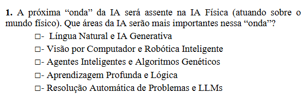

A resposta que melhor corresponde aos slides é:

**✅ Visão por Computador e Robótica Inteligente**

A palavra decisiva na pergunta é **“IA Física (atuando sobre o mundo físico)”**. Nos slides de Robótica, o professor caracteriza precisamente os robots como entidades com **existência física**, que **interagem fisicamente com o meio**, usam **sensores externos para perceber a realidade física** e **atuadores para alterar o estado do mundo**. 7 - T Slides IARTI - Robótica I…

Além disso, no slide sobre **Robótica Inteligente**, é dito que ela resulta da conjugação da **Robótica com a IA**, permitindo ao robot **interpretar o meio através dos sensores**, raciocinar e **atuar em ambientes não estruturados**. O próprio slide faz explicitamente a ligação à **Visão por Computador** quando fala da introdução de sensores nos robots. 7 - T Slides IARTI - Robótica I…

A **Visão por Computador** fornece a parte da **perceção**: os slides definem-na como a área que procura reconhecer informação numa imagem digital, por exemplo identificar **objetos presentes numa estrada**. 6 - T Slides IARTI Visão por Co…

Portanto, a ideia mais fácil de memorizar é:

**Visão por Computador = perceber o mundo físico → Robótica Inteligente = agir sobre o mundo físico.**

É exatamente o ciclo necessário à **IA Física**:

**Mundo físico → sensores/câmaras → Visão por Computador → decisão → Robótica/atuadores → mundo físico**

### Porque não são as outras opções?

| Opção | Porque não é a melhor resposta |
|---|---|
| **Língua Natural e IA Generativa** | Estão sobretudo associadas à compreensão e geração de texto, tradução, interfaces, bots, geração de código, etc. Os próprios slides apresentam essas aplicações para Língua Natural. 8 - T Slides IARTI - Lingua Nat… São importantes, inclusive para um robot comunicar com pessoas, mas **não são as tecnologias centrais para perceber e atuar fisicamente no ambiente**. |
| **Visão por Computador e Robótica Inteligente** | **✅ CORRETA.** A Visão permite ao sistema perceber objetos e o ambiente; a Robótica Inteligente permite utilizar sensores, raciocinar e atuar fisicamente através de atuadores. É a combinação que corresponde diretamente à definição de IA Física nos slides. |
| **Agentes Inteligentes e Algoritmos Genéticos** | Os agentes podem ter autonomia e utilizar ferramentas, portanto são relevantes para sistemas autónomos. Nos slides, porém, os agentes são apresentados no contexto dos LLMs e da automatização de sequências/tarefas. 9 - T Slides IART GenAI+LLM+Age… Os Algoritmos Genéticos são apresentados como **Computação Evolucionária para encontrar soluções de problemas**, usando populações, reprodução, mutação e seleção. 4 - T Slides IART - Métodos de … Nenhuma das duas áreas implica, por si só, **percecionar e manipular o mundo físico**. |
| **Aprendizagem Profunda e Lógica** | A Aprendizagem Profunda é muito importante e certamente será utilizada na IA Física. Aliás, os slides dizem que faz compreensão de imagem, língua natural, geração de imagem/texto, etc., mostrando que é uma tecnologia **transversal**. 5 - T Slides IARTI - Redes Neur… Mas “Deep Learning + Lógica” não fornece diretamente a componente física de **sensores + perceção + movimento + atuadores**. A Visão e a Robótica são uma resposta muito mais específica à pergunta. |
| **Resolução Automática de Problemas e LLMs** | A Resolução Automática de Problemas trata de passar de uma situação inicial para uma situação pretendida respeitando regras e restrições. 3 - T Slides IART - Resolução A… É importante para planeamento e decisão, mas não trata especificamente da perceção e atuação física. E os próprios slides dizem que os LLMs se destacam na compreensão/geração de linguagem e podem ter dificuldades em raciocínio complexo. 9 - T Slides IART GenAI+LLM+Age… |

Há uma distinção importante para o exame: **não significa que Deep Learning, LLMs ou agentes deixem de ser importantes**. Um robot humanoide moderno pode perfeitamente utilizar **Deep Learning + Visão + LLM + agentes + planeamento**. Mas a pergunta pede quais serão as áreas **“mais importantes nessa onda” da IA Física** e, entre as alternativas dadas, a combinação que representa diretamente **perceber fisicamente + atuar fisicamente** é:

### **✅ Visão por Computador e Robótica Inteligente**

Se aparecer esta pergunta no teste, pense simplesmente: **“Para agir no mundo físico, a máquina tem de VER e AGIR: Visão + Robótica.”**